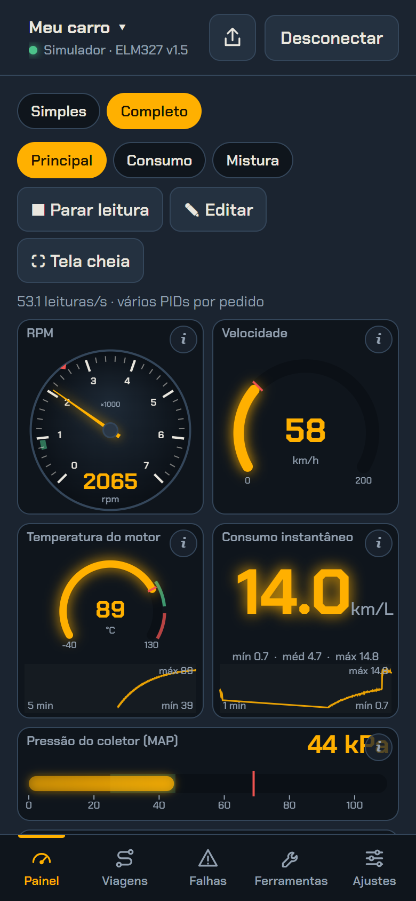
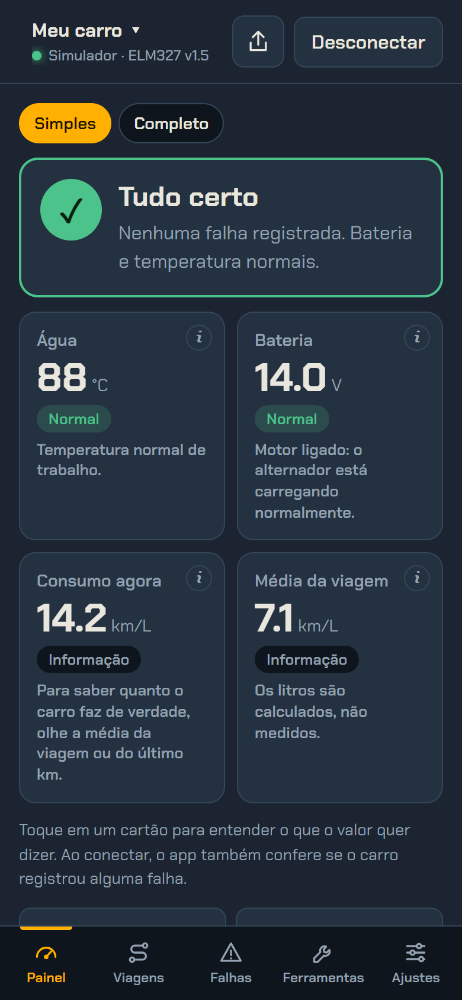
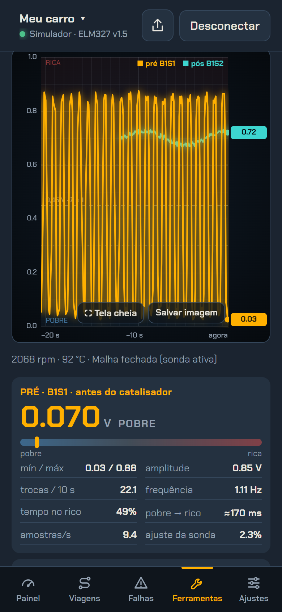
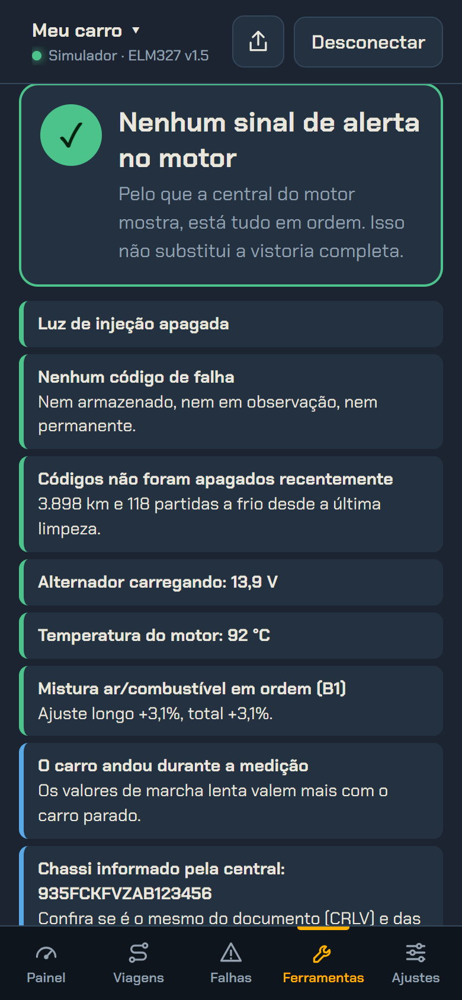

# ELM327 Scanner

Scanner OBD-II que roda no navegador e conversa com adaptadores ELM327 via **Web Bluetooth** (BLE) ou **Web Serial** (Bluetooth clássico/USB). Sem build, sem conta e sem servidor: tudo fica no aparelho.

[](https://paulpessoa.github.io/elm327-scanner/) [](https://github.com/paulpessoa/elm327-scanner/actions/workflows/test.yml) 

Sem adaptador? Use o **Modo demonstração**, um ELM327 simulado com motor virtual.



| Modo simples | Sondas lambda | Vistoria de usado |
|---|---|---|
|  |  |  |

<sub>Imagens do modo demonstração (motor simulado).</sub>

## Compatibilidade
| | Web Bluetooth (BLE) | Web Serial (Bluetooth clássico/USB) | Janela flutuante | Tela bloqueada |
|---|---|---|---|---|
| Chrome Android (Samsung: use o Chrome, não o Samsung Internet) | ✅ | depende da versão | ✅ | ✅ (player de mídia) |
| Chrome/Edge Windows, Mac, Linux | ✅ | ✅ (117+) | ✅ | controle de mídia |
| iPhone | só pelo app Bluefy | ❌ | ❌ | ❌ |

O Bluetooth exige HTTPS ou `localhost`, e não funciona se a página estiver dentro de um iframe.

## Como funciona
1. **Conexão** (`js/core.js`): Web Bluetooth (serviços GATT típicos de clones ELM327) ou Web Serial, atrás da mesma fila de comandos.
2. **Comandos ELM327**: `AT` para configurar o adaptador e detectar o protocolo (`ATSP0`, `ATDPN`, com fallback protocolo por protocolo), depois os pedidos OBD-II (modos `01`, `02`, `03`, `04`, `07`, `09`, `0A`).
3. **Decodificação** (SAE J1979): a tabela `PIDS` converte os bytes da resposta em valores (RPM, temperatura, ajustes de combustível, lambda…) e `decodeDTC` transforma os pares de bytes em códigos como `P0133`.
4. **Laço de leitura** (`js/engine.js`): um único laço atende todas as telas. Cada tela pede os sensores que quer; as sondas lambda entram como "rápidas" e são lidas em toda volta. Em carros CAN, até 6 PIDs vão num só pedido, o que leva o simulador a ~50 leituras/s (adaptadores reais BLE costumam fazer 10–25 em CAN e 3–8 em K-line).
5. **Interface**: mostradores, painel, alertas, viagens e vistoria, em JavaScript puro, sem framework nem build.

## Por que existe
Para chegar na oficina sabendo o que o carro está dizendo. O app lê o que a central do motor já informa pela tomada OBD-II: sensores, códigos de falha, sondas lambda e consumo. Assim dá para conhecer o veículo, acompanhar a saúde dele, conversar com o mecânico com dados na mão e evitar trocar peça no chute.

É seguro por natureza: o OBD-II genérico serve para **ler**. A única escrita que o app faz é apagar códigos de falha, e só quando você confirma. Reprogramar módulos, codificar peças ou mexer em imobilizador exige ferramentas e códigos de acesso da montadora, que este app não tem nem tenta usar. Ele não substitui o mecânico: é o "exame" que você leva para a consulta.

## O que faz
- **Feito para o suporte do carro**: barra fixa embaixo (Painel, Viagens, Falhas, Ferramentas, Ajustes), em pé ou deitado, e um botão só para conectar. O botão Voltar do celular navega entre as telas.
- **Veículos**: cada carro tem os próprios dados (consumo, combustível, preço, calibração, alertas, viagem, linha de base, manutenção e abastecimentos). Troca tocando no nome do carro no topo. O painel é o mesmo para todos.
- **Painel personalizável** (inspirado nos apps de painel de carro): várias páginas, mostradores de **ponteiro, arco, digital, barra, barra vertical e gráfico**, cada um com escala, cor, tamanho, marca de pico, mín/méd/máx e **histórico embutido** (10 s a 15 min). Toque e segure para configurar. Tela cheia deitada para usar no suporte.
- **Modo simples** (padrão em instalação nova): um “Tudo certo / Atenção / Procure um mecânico” e quatro cartões grandes (água, bateria, consumo agora e média). O painel completo continua a um toque.
- **Falhas conferidas ao conectar**: lê os códigos armazenados e pendentes, avisa quando aparece um código novo e explica os mais comuns em português simples.
- **Botão “i” em cada sensor**: explica em linguagem simples o que é o valor, se está normal agora (com motor frio/quente, lenta ou andando), causas comuns quando está fora e a comparação com a linha de base do seu carro.
- **Vistoria de usado** (Ferramentas): laudo em uns 40 segundos para quem vai comprar um carro. Junta falhas armazenadas, pendentes e **permanentes** (as que o scanner não apaga), sinais de **códigos apagados há pouco** (km e partidas a frio desde a limpeza, monitores incompletos), bateria, temperatura, mistura, marcha lenta, chassi e, se o carro informar, o hodômetro da central. Salva em PDF.
- **Viagens**: uma por conexão, com km, km/L, custo, tempo parado, giro alto, acelerações, frenagens e **curvas** fortes, avaliação do estilo (pé leve, moderado, pesado) e dicas. Comparação de consumo entre estilos. As curvas vêm do sensor de movimento do celular preso no suporte (opcional).
- **Rever a viagem**: cada viagem grava as leituras, o trajeto do GPS e os eventos. Dá para tocar de novo em 1× a 60×, com os mostradores do seu painel, uma linha do tempo com velocidade, giro e eventos, e o trajeto colorido pela velocidade. Também dá para baixar em CSV. Ficam as 30 viagens mais recentes, só no aparelho.
- **Quilometragem e trocas** (tela Viagens): km atual do carro (informado ou do último abastecimento, somando o que o app rodou depois) e itens de manutenção com intervalo e última troca, mostrando quanto falta ou há quanto venceu. Cada carro tem a sua ficha.
- **Abastecimentos**: hodômetro e litros no posto dão o km/L real entre tanques cheios e mostram, no seu carro, até quantos % do preço da gasolina o etanol compensa.
- **Alertas por sensor** (mínimo e máximo): o mostrador fica vermelho, toca, vibra e manda notificação do sistema. Tem atraso e histerese para não ficar disparando no limite.
- **Sondas lambda**: osciloscópio da pré e da pós-catalisador com leitura prioritária, trocas por 10 s, frequência, amplitude, tempo no rico, tempo de resposta, **índice do catalisador**, diagnóstico automático (só julga em malha fechada) e **teste de resposta** (acelerar e soltar). Suporta sondas de banda larga.
- **Consumo e viagem**: L/h, km/L instantâneo, média da viagem, **km/L de cada km rodado**, L/100 km, distância, litros e custo. Médias são sempre distância ÷ litros. Litros vêm da ECU (PID 5E), do MAF ou da pressão do coletor (speed-density), e o app mostra qual. Calibração pelo posto.
- **GPS do celular** como fonte da distância (opcional): hodômetro do OBD e do GPS lado a lado, com filtro de precisão e de ponto parado.
- **Fora do app**: manter tela ligada, **janela flutuante** (picture-in-picture, por cima de outros apps), valores no **player da tela bloqueada** do Android e notificação fixa.
- **Tensão** da bateria (`ATRV`) com gráfico e calibração (`ATCV`)
- **Ficha**: versão, teste de clone, protocolo, PIDs suportados, padrão OBD, combustível, VIN e serviços GATT
- **Sensores**: todos os PIDs do modo 01 que a ECU suporta, com gravação em CSV (`;` e vírgula decimal, para o Excel em português)
- **Falhas**: lê (`03`), pendentes (`07`) e apaga (`04`) códigos; monitores de prontidão e congelamento (`02`)
- **Modelos com guia**: Citroën C3 2010 1.4 TU3JP, Fiat Mobi 1.0 (Fire Evo ou Firefly, manual, direção hidráulica) e Renault Duster 2018 (1.6 SCe ou 2.0, manual, 4x2), com cilindrada, referências e roteiro de teste. Qualquer veículo tem **linha de base**: 2 min de marcha lenta gravados no próprio carro, para comparar depois.
- **Compartilhar e perguntar à IA** pelo botão ⤴ do topo: os dados da tela atual ou o **Relatório completo**, num JSON
- **Backup**: exporta e importa painéis, alertas, viagem e ajustes para levar a outro aparelho
- **Modo demonstração**: um ELM327 simulado com motor virtual (CAN), para testar sem carro
- Funciona **offline** e pode ser instalado como app (PWA)

## Arquivos
| Arquivo | Conteúdo |
|---|---|
| `index.html`, `app.css` | Página e estilos |
| `js/core.js` | Transporte BLE/Serial, protocolo ELM327, PIDs, ficha, falhas, exportação |
| `js/config.js` | Configuração local e validação de tudo que é importado |
| `js/engine.js` | Laço de leitura, multi-PID, histórico, sensores calculados |
| `js/gauges.js`, `js/dash.js` | Mostradores e painel |
| `js/alerts.js`, `js/lambda.js`, `js/outside.js` | Alertas, osciloscópio das sondas, exibição fora do app |
| `js/gps.js`, `js/cars.js` | Distância pelo GPS; veículos, catálogo de modelos e linha de base |
| `js/maint.js` | Quilometragem e trocas de manutenção |
| `js/health.js` | Modo simples, verificação de falhas ao conectar e códigos explicados |
| `js/explain.js`, `js/trips.js` | Explicação de cada sensor; viagens, estilo de direção, dicas e abastecimentos |
| `js/rec.js` | Gravação das viagens no IndexedDB e tela Rever viagem |
| `js/motion.js` | Força lateral nas curvas pelo sensor de movimento do celular |
| `js/inspect.js` | Vistoria de carro usado |
| `js/settings.js`, `js/demo.js` | Consumo do veículo, viagem e backup; simulador |
| `js/nav.js`, `js/main.js` | Barra de baixo, conectar e compartilhar; inicialização |
| `sw.js`, `manifest.webmanifest` | Offline, notificações e instalação |

## Segurança e privacidade
- Nenhum dado sai do aparelho (a não ser quando o usuário escolhe exportar ou perguntar a uma IA).
- As gravações das viagens (com o trajeto do GPS) ficam no IndexedDB do navegador, fora do backup, e são apagadas junto com "Apagar dados deste aparelho".
- `Content-Security-Policy` com `script-src 'self'`: nenhum script inline ou de outro domínio roda.
- Backups importados são reconstruídos campo a campo (chaves conhecidas, números com limites, textos curtos); textos são sempre escapados ao aparecer na tela.

## Rodar localmente
```bash
python3 -m http.server 8000
# abrir http://localhost:8000 no Chrome
```

## Testes
A decodificação (PIDs e códigos de falha) tem testes sem dependências, com o `node:test` do Node:
```bash
node --test
```

## Contribuir
Contribuições são bem-vindas, inclusive no **Hacktoberfest**: código, perfis de carros, textos explicativos e testes no seu carro. Não tem build, então basta clonar, rodar o servidor acima e usar o **Modo demonstração**.

- Leia o [guia de contribuição](CONTRIBUTING.md).
- Comece pelas issues [`good first issue`](https://github.com/paulpessoa/elm327-scanner/labels/good%20first%20issue) e [`hacktoberfest`](https://github.com/paulpessoa/elm327-scanner/labels/hacktoberfest).
- Testou no seu carro? Conte como foi com o modelo de issue [Meu carro](https://github.com/paulpessoa/elm327-scanner/issues/new?template=carro.yml).

## Licença
[MIT](LICENSE)
